<a id="top"></a>

<div align="center">
  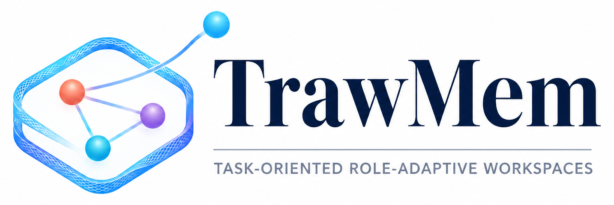
  <h1>TrawMem: Reframing Agent Memory as Task-Oriented Role-Adaptive Workspaces</h1>
  <div>
    <a target="_blank" href="https://zh-mingyu.github.io/">Mingyu&#160;Zhang</a><sup>1</sup>,
    <a target="_blank" href="https://lee-zixu.github.io/">Zixu&#160;Li</a><sup>1,&#8224;</sup>,
    <a target="_blank" href="https://zhihfu.github.io/">Zhiheng&#160;Fu</a><sup>1</sup>,
    <a target="_blank" href="https://zivchen-ty.github.io/">Zhiwei&#160;Chen</a><sup>1</sup>,
    <a target="_blank" href="https://jinhe-bi.github.io/">Jinhe&#160;Bi</a><sup>2</sup>,
    <a target="_blank" href="https://faculty.sdu.edu.cn/huyupeng1/zh_CN/index.htm">Yupeng&#160;Hu</a><sup>1,&#9993;</sup>
  </div>
  <sup>1</sup>School of Software, Shandong University &#160;&#160;&#160;
  <sup>2</sup>National University of Singapore
  <br />
  <sup>&#8224;</sup>Project leader &#160;&#160;&#160; <sup>&#9993;</sup>Corresponding author
  <br />
  <p>
    <a href="https://arxiv.org/abs/2610.36918"></a>
    <a href="https://zh-mingyu.github.io/TrawMem.github.io/"></a>
    <a href="https://www.python.org/"></a>
    <a href="LICENSE"></a>
    <a href="https://github.com/zh-mingyu/Traw-Mem/stargazers"></a>
    <a href="https://github.com/zh-mingyu/Traw-Mem/pulls"></a>
  </p>
  <p>
    <b>Official Implementation:</b> Reframing LLM agent memory from relevance-based retrieval to
    query-local workspaces, where memories are selected and organized by the task-oriented roles
    they play rather than by semantic similarity alone.
  </p>
</div>

## 📑 Table of Contents

- [📌 Introduction](#-introduction)
- [📢 News](#-news)
- [✨ Key Features](#-key-features)
- [🏗️ Architecture](#️-architecture)
- [📊 Experiment Results](#-experiment-results)
- [📂 Repository Structure](#-repository-structure)
- [🚀 Installation](#-installation)
- [📂 Data Preparation](#-data-preparation)
  - [LoCoMo](#locomo)
  - [MemGallery](#memgallery)
- [🏃 Quick Start](#-quick-start)
  - [1. Minimal Usage](#1-minimal-usage)
  - [2. Evaluating on LoCoMo](#2-evaluating-on-locomo)
  - [3. Evaluating on MemGallery](#3-evaluating-on-memgallery)
- [🔧 Configuration](#-configuration)
- [🧪 Tests](#-tests)
- [🤝 Acknowledgements](#-acknowledgements)
- [✉️ Contact](#️-contact)
- [📝 Citation](#-citation)
- [🔗 Related Projects](#-related-projects)
- [🫡 Support & Contributing](#-support--contributing)
- [📄 License](#-license)

---

## 📌 Introduction

Welcome to the official repository of **TrawMem** (arXiv preprint).

Existing LLM agent memory systems retrieve memories by their relevance to the current query and
feed them as flat contextual evidence. But relevance alone does not characterize how a memory
*contributes* to a task: the same memory may directly answer one question, connect two events for
another, or merely supply temporal context for a third. **TrawMem** reframes agent memory as
**Task-Oriented Role-Adaptive Workspaces**. It organizes an interaction history into source-faithful
**local threads**, links them into a sparse **thread graph**, and — given a query — localizes a
thread neighborhood, assigns each candidate memory a query-local role (**Anchor**, **Bridge**, or
**Context**), and assembles a bounded **workspace** of complementary memories for the answer model.
Role assignments are never persisted: they are a per-query view over the same memory bank.

<div align="center">
<p align="center">
  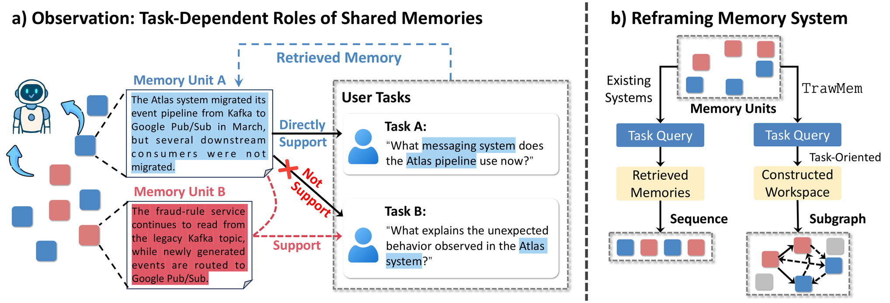

<strong>Figure 1.</strong> (a) The same memory plays different task-dependent roles: Memory Unit A directly supports Task A but only bridges Task B, while Memory Unit B supports Task B. (b) Existing systems retrieve a sequence of memory units; TrawMem constructs a task-oriented workspace, a query-local subgraph over the persistent memory structure.
</p>
</div>

[⬆ Back to top](#top)

## 📢 News

* **[2026-10-28]** 🚀 We release the official code, configuration template, and evaluation harness of TrawMem.
* **[2026-10-27]** 📄 TrawMem is available on arXiv: [arXiv:2610.36918](https://arxiv.org/abs/2610.36918).
* **[2026-10]** 🎯 TrawMem is submitted to **ICLR 2027**.

[⬆ Back to top](#top)

## ✨ Key Features

* 🧵 **Source-faithful local threads.** Interaction histories are segmented into contiguous event
  threads, each with a routing synopsis and an ordered ledger of the original turns. Turns are never
  rewritten into query-specific semantic memories, so provenance, order, and temporal cues survive.
* 🕸️ **Persistent sparse thread graph.** Threads are connected by chronological and semantic
  relations, giving retrieval a structure to traverse instead of a flat vector index.
* 🎯 **One route, bounded local expansion.** A single routing pass localizes the task-relevant
  neighborhood and expands it under hop-count and neighborhood-size limits — no repeated
  query-conditioned global retrieval.
* 🎭 **Query-local roles.** Each candidate memory receives an Anchor / Bridge / Context role
  conditioned on the query's demand. Roles are frozen for the current workspace and discarded
  afterwards, so the memory bank never stores query-specific labels.
* 🧩 **Structured coverage selection.** Workspace construction maximizes a monotone submodular
  coverage objective with a budget, giving a greedy `1 - 1/e` guarantee on the base objective and
  preferring complementary over redundant memories.
* ⚡ **Efficiency by design.** On LoCoMo, TrawMem answers with ~12.8% / ~5.1% fewer answer-context
  tokens than SimpleMem under Qwen3.5-9B / DeepSeek-V4-Flash, while scoring higher; the expansion
  depth `H` provides a tunable quality–cost trade-off.

[⬆ Back to top](#top)

## 🏗️ Architecture

<p align="center">
  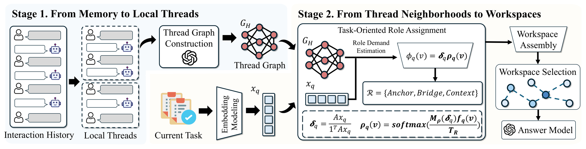
  <figcaption><strong>Figure 2.</strong> Overview of TrawMem. <b>Stage 1</b> organizes the interaction history into local threads and a thread graph. <b>Stage 2</b> localizes a thread neighborhood for the current task, estimates the task's role demand, assigns query-local roles to candidate memories, and assembles a bounded workspace for the answer model.</figcaption>
</p>

TrawMem consists of two stages:

**Stage 1 — From memory to local threads.** Raw records are grouped into contiguous event threads
`T_j = (a_j, L_j)`, where `a_j` is an LLM-generated routing synopsis (the thread head) and `L_j` is
the ordered ledger of original turns. Thread heads are embedded to index the bank; chronological and
semantic links between heads form the persistent thread graph `G_H`.

**Stage 2 — From thread neighborhoods to workspaces.** The query is embedded and matched against
thread heads. The top-`K` threads are seeds; scores propagate along `G_H` under depth `H` and
neighborhood-size `M_max` limits to induce the task-relevant neighborhood. Within it, the system
estimates the query's role demand, assigns soft roles to candidate units, and greedily selects a
workspace of at most `B_q` units that maximizes a monotone submodular coverage objective combining
query affinity, role compatibility, thread coverage, and local graph structure.

[⬆ Back to top](#top)

## 📊 Experiment Results

TrawMem is evaluated on two long-horizon conversational memory benchmarks, **LoCoMo** (four question
types: Multi-hop, Temporal, Open-domain, Single-hop) and **MemGallery** (nine question types), with
four answer backbones: Qwen3.5-9B, Qwen3.8-27B, DeepSeek-V4-Flash, and GPT-5.6-Luna. Metrics are
token-level **F1**, **BLEU-1 (B-1)**, and **LLM-Judge (J)**. LoCoMo numbers are macro-averaged over
the four question types; MemGallery numbers are macro-averaged over the nine question types. The
three tables below are the paper's main tables (click a table to open the full-resolution image).

### 1. LoCoMo

<p align="center">
  <a href="assets/results-locomo.png">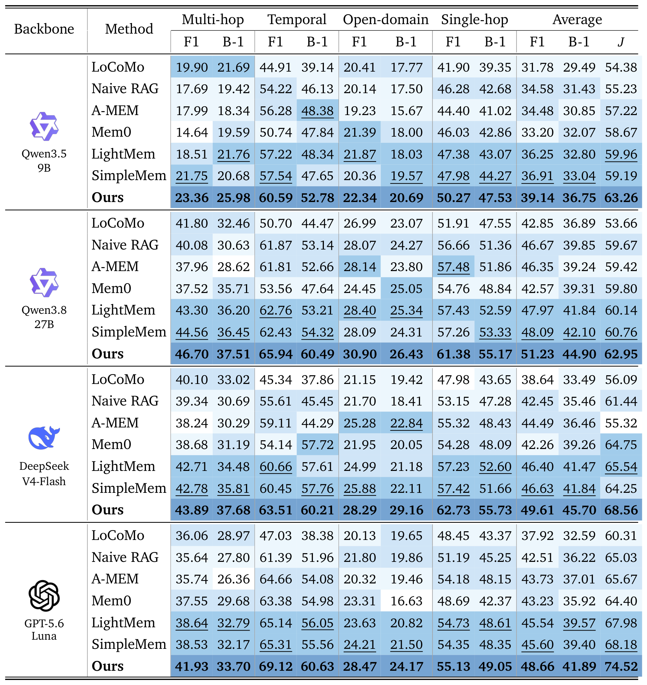</a>
</p>

**Table 1 (paper).** Macro-averaged LoCoMo results over the four question types (Multi-hop, Temporal,
Open-domain, Single-hop). F1, BLEU-1 (B-1), and LLM-Judge (J) are reported. Bold / underlined values
are the best / second-best results; darker shading indicates higher scores.

TrawMem achieves the best average F1, B-1, and J under all four backbones. With Qwen3.5-9B it
improves over the second-best baseline by **+2.23 / +3.71 / +3.30** points (F1 / B-1 / J); with
GPT-5.6-Luna by **+3.06 / +2.32 / +6.34**. The gain is especially pronounced on Temporal questions:
B-1 reaches 52.78 (Qwen3.5-9B) and 60.49 (Qwen3.8-27B), exceeding the second-best baselines by
**4.40** and **6.17** points.

### 2. MemGallery

<p align="center">
  <a href="assets/results-memgallery.png">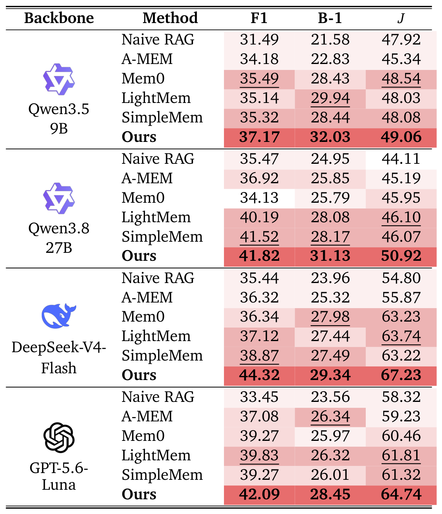</a>
</p>

**Table 2 (paper).** Macro-averaged MemGallery results for the four answer backbones over the nine
question types. Bold / underlined values are the best / second-best results.

Relative to the second-best baseline for each backbone, TrawMem's F1 / B-1 / J gains are
**+0.30–5.45 / +1.36–2.96 / +0.52–4.82** points. MemGallery's nine question types span more diverse
semantic granularity and reasoning depth, indicating that role-based workspace organization still
helps when a single relevance score is least informative.

### 3. Efficiency

<p align="center">
  <a href="assets/results-efficiency.png">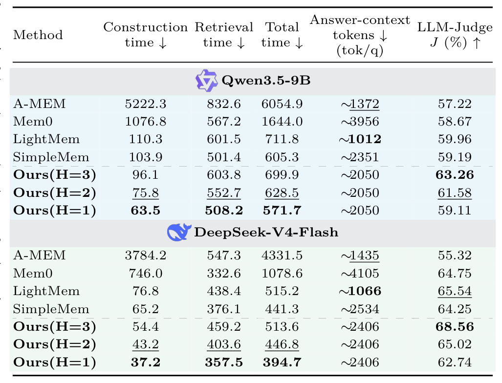</a>
</p>

**Table 3 (paper).** Efficiency and answer quality on LoCoMo. Construction / Retrieval / Total time
are in s/root; Answer-context tokens are per question (tok/q); J is the LLM-Judge score. H is the
maximum thread-neighborhood expansion depth.

Compared with SimpleMem, TrawMem (H=3) uses **12.8%** (Qwen3.5-9B) and **5.1%**
(DeepSeek-V4-Flash) fewer answer-context tokens while raising J by **+4.07** and **+4.31** points.
The extra total time comes mainly from graph traversal during retrieval; reducing `H` from 3 to 1
cuts total time by 18.3% (Qwen3.5-9B) / 23.2% (DeepSeek-V4-Flash) without changing the answer-context
token count.

### 4. Ablation Study

Six components are ablated: event thread construction (**Fixed Seg.**), inter-thread semantic
connections (**No Cross-Edge**), neighborhood expansion (**Seed-only**), task-oriented roles
(**No Role Cond.**), structured coverage (**Identity K**), and multi-thread selection
(**No Multi-thread**). The metric is the change in LLM-Judge score relative to the full model,
`ΔJ = J_variant − J_full`; all variants degrade performance, confirming every component contributes.

<p align="center">
  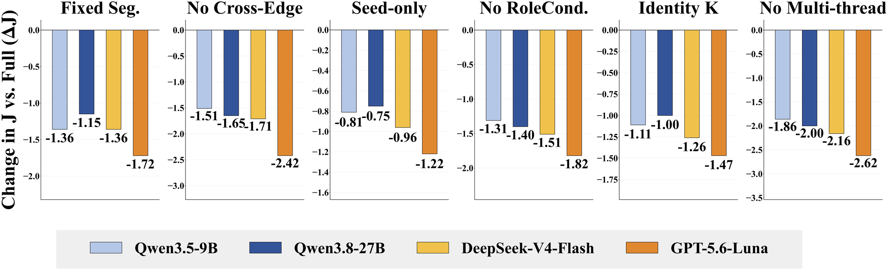
  <br>
  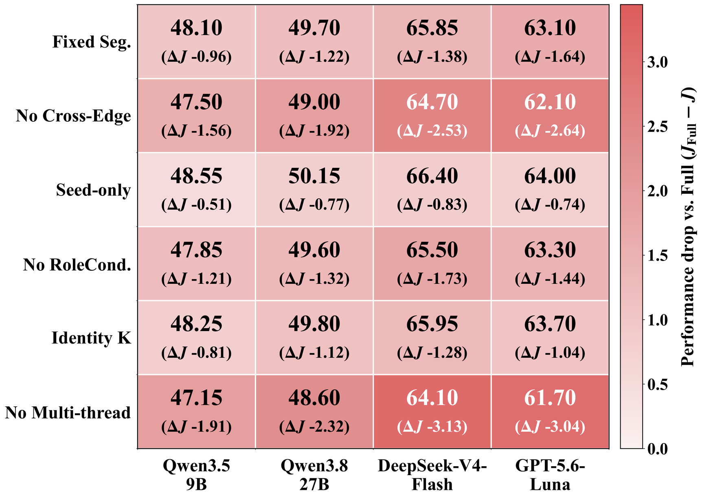
</p>

**No Multi-thread** causes the largest drop (−1.86 to −2.62 on LoCoMo, −1.91 to −3.13 on
MemGallery), followed by **No Cross-Edge**: both kinds of inter-thread structure matter, not just
candidate expansion. **Fixed Seg.** and **Seed-only** confirm the value of event-level thread
construction and local neighborhood expansion over fixed windows and direct seed retrieval.
**No Role Cond.** generally hurts more than **Identity K**, showing that role modeling and structured
coverage jointly select complementary rather than redundant information.

### 5. Parameter Sensitivity

<p align="center">
  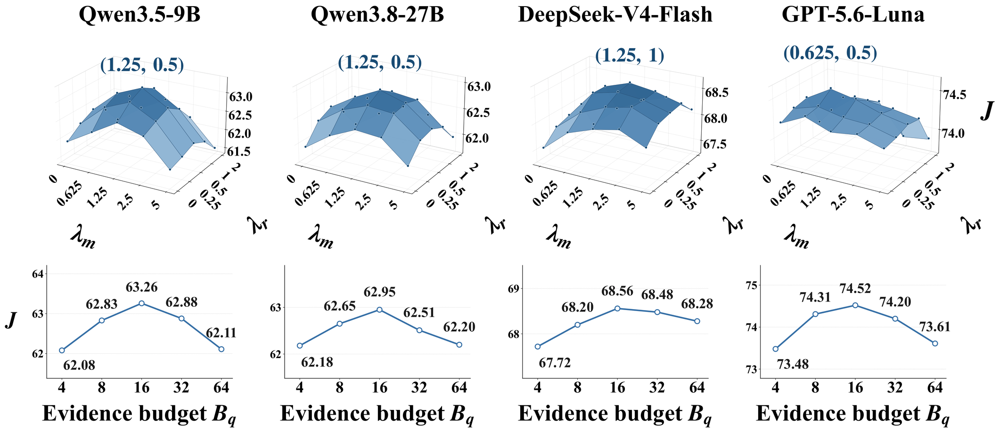
</p>

The top row varies the cost weights `λ_m` and `λ_r` jointly; the bottom row varies the evidence budget
`B_q`. Optima are located at `(λ_m, λ_r) = (1.25, 0.5)` for Qwen3.5-9B and Qwen3.8-27B,
`(1.25, 1.0)` for DeepSeek-V4-Flash, and `(0.625, 0.5)` for GPT-5.6-Luna — neighbouring regions with
no sharp degradation, i.e. reasonable robustness. `B_q = 16` is the consistent optimum across all
four backbones: too small a budget omits necessary evidence, while too large a budget admits
redundant memories.

[⬆ Back to top](#top)

## 📂 Repository Structure

```text
TrawMem/
├── main.py                     # 🚀 TrawMemSystem public API
├── trawmem/                    # 🧠 method implementation
│   └── core/
│       ├── memory_builder.py    #    event-thread construction
│       ├── thread_store.py      #    persistent thread bank + thread graph
│       ├── hybrid_retriever.py  #    one-route localization + bounded expansion
│       ├── workspace.py         #    roles, activation, coverage selection
│       ├── answer_generator.py  #    workspace-to-answer readout
│       ├── prompts.py           #    construction / answering / judging prompts
│       ├── settings.py          #    config resolution (config.py → env → default)
│       ├── config_default.py    #    default configuration (copy to config.py)
│       ├── models/memory_entry.py
│       └── utils/               #    LLM client + embedding model
├── test_locomo10.py            # 🧪 LoCoMo evaluation adapter (F1 / BLEU-1 / J)
├── test_memgallery.py          # 🧪 MemGallery evaluation adapter
├── tests/                      # ✅ unit and adapter tests
├── assets/                     # 🖼️ README figures, logo, related-project logos
├── requirements.txt
├── setup.py
├── LICENSE
├── .gitignore
└── README.md
```

## 🚀 Installation

**1. Clone the repository**

```bash
git clone https://github.com/zh-mingyu/Traw-Mem.git
cd TrawMem
```

**2. Create the environment** (Python 3.10–3.12)

```bash
conda create -n trawmem python=3.10 -y
conda activate trawmem
```

**3. Install dependencies**

```bash
pip install -r requirements.txt
pip install -e .
```

`requirements.txt` installs the runtime (`openai`, `pydantic`, `lancedb`,
`sentence-transformers`) and evaluation (`tqdm`) dependencies. The embedding model
(`Qwen/Qwen3-Embedding-0.6B`) is downloaded automatically by `sentence-transformers` on first use;
you can also point `EMBEDDING_MODEL` at a local path.

## 📂 Data Preparation

Datasets are **not** included in this repository. Download them from their official sources and
place them under `data/` (git-ignored).

### LoCoMo

Download `locomo10.json` from the [official LoCoMo repository](https://github.com/snap-research/locomo)
and place it at `data/locomo10.json`:

```text
data/
└── locomo10.json
```

Each sample contains a multi-session `conversation`, its `qa` list (with `category` and `evidence`),
`event_summary`, and `observation` fields. The evaluator reads all of them directly.

### MemGallery

Download the official release, *Mem-Gallery: Benchmarking Multimodal Long-Term Conversational
Memory for MLLM Agents* ([arXiv:2601.03515](https://arxiv.org/abs/2601.03515)), from the
[🤗 Hugging Face dataset](https://huggingface.co/datasets/Ethan-Bei/Mem-Gallery), and point
`--dataset` at the downloaded directory that contains `dialog/`. We recommend placing it at
`data/memgallery/`:

```text
data/memgallery/
├── dialog/
│   ├── <topic>.json
│   └── ...
└── image/          # optional: TrawMem reads only text and image captions
```

Each topic file provides `character_profile`, `multi_session_dialogues`, and
`human-annotated QAs`. Following the paper's protocol, TrawMem uses the **text and image description
fields only** — no raw image encoder is invoked.

## 🏃 Quick Start

### 1. Minimal Usage

```python
from main import TrawMemSystem

system = TrawMemSystem()
system.add_dialogue("Alice", "Bob and I will meet tomorrow at 2pm.")
system.add_dialogue("Bob", "I will bring the draft review.")
system.finalize()

print(system.ask("When will Alice and Bob meet?"))
```

The first run downloads the embedding model and requires a working OpenAI-compatible LLM endpoint.
See [Configuration](#-configuration) for how to set the backbone and API key.

### 2. Evaluating on LoCoMo

```bash
PYTHONPATH=. python test_locomo10.py \
  --dataset data/locomo10.json \
  --result-file results/locomo.json \
  --llm-judge
```

The evaluator constructs memory for each conversation in chronological order, answers every question
against the frozen memory state, and reports F1, BLEU-1, and LLM-Judge scores, together with
per-question retrieval time, answer time, answer-context tokens, and workspace statistics.

### 3. Evaluating on MemGallery

```bash
PYTHONPATH=. python test_memgallery.py \
  --benchmark memgallery \
  --dataset data/memgallery \
  --result-file results/memgallery.json \
  --llm-judge
```

Both adapters also accept `--shard-index` / `--num-shards` for parallel evaluation and
`--num-samples` for quick smoke tests; results are written as JSON with per-question rows.

## 🔧 Configuration

TrawMem resolves every setting from, in order: a local `config.py`, an environment variable of the
same name, then the built-in default. The evaluation scripts import this local `config.py`, so
create it before running anything:

```bash
cp trawmem/core/config_default.py config.py
```

and edit it (at minimum `OPENAI_API_KEY`, `OPENAI_BASE_URL`, and `LLM_MODEL`). Never commit
`config.py` — it is git-ignored. Environment variables are convenient for cluster runs and sweeps:

```bash
LLM_MODEL="Qwen3.5-9B" OPENAI_BASE_URL="http://localhost:8000/v1" \
  python test_locomo10.py --dataset data/locomo10.json --result-file results/locomo.json --llm-judge
```

**Backbones.** Set `LLM_MODEL` (and `OPENAI_BASE_URL` for self-hosted or third-party endpoints) to
the model used for answer generation. In the paper, Qwen3.5-9B and Qwen3.8-27B were served locally,
while DeepSeek-V4-Flash and GPT-5.6-Luna were accessed through their official APIs. By default the
LLM judge reuses the answer backbone; set `JUDGE_MODEL` / `JUDGE_BASE_URL` via the `JUDGE_*` settings to
judge with a different model (Appendix E.3 of the paper).

## 🧪 Tests

```bash
pip install pytest
PYTHONPATH=. python -m pytest -q
```

The suite covers thread construction, routing/expansion budget handling, role assignment, workspace
selection, prompt construction, benchmark loaders, fail-closed evaluation, and LLM key rotation. It
does **not** call external APIs.

[⬆ Back to top](#top)

## 🤝 Acknowledgements

This project builds on the [LoCoMo](https://github.com/snap-research/locomo) and
[Mem-Gallery](https://arxiv.org/abs/2601.03515) benchmarks, and is implemented with
[LanceDB](https://lancedb.com/), [Sentence Transformers](https://www.sbert.net/), and
[Qwen3-Embedding](https://huggingface.co/Qwen/Qwen3-Embedding-0.6B). We thank the open-source
community for these resources. We also note that generative AI tools were used only for English
polishing and presentation during the preparation of the paper.

## ✉️ Contact

If you have questions, feel free to open an [issue](https://github.com/zh-mingyu/Traw-Mem/issues) or
contact:

- Mingyu Zhang — `zhmingyu.cs@gmail.com`
- Zixu Li — `lizixu.cs@gmail.com`

## 📝 Citation

If you find our work or this code useful, please consider giving the repository a **Star** ⭐ and
citing our paper:

```bibtex
@article{zhang2026trawmem,
  title   = {TrawMem: Reframing Agent Memory as Task-Oriented Role-Adaptive Workspaces},
  author  = {Zhang, Mingyu and Li, Zixu and Fu, Zhiheng and Chen, Zhiwei and Bi, Jinhe and Hu, Yupeng},
  journal = {arXiv preprint arXiv:2610.36918},
  year    = {2026}
}
```

## 🔗 Related Projects

*Other works from our team:*

<table style="width:100%; border:none; text-align:center; background-color:transparent;">
  <tr style="border:none;">
    <td style="width:33%; border:none; vertical-align:top; padding-top:30px;">
      <br>
      <b>TEMA (ACL'26)</b><br>
      <span style="font-size: 0.9em;">
        <a href="https://arxiv.org/abs/2604.21806" target="_blank">Paper</a> |
        <a href="https://lee-zixu.github.io/TEMA.github.io/" target="_blank">Project</a> |
        <a href="https://github.com/iLearn-Lab/ACL26-TEMA" target="_blank">Code</a>
      </span>
    </td>
    <td style="width:33%; border:none; vertical-align:top; padding-top:30px;">
      <br>
      <b>ConeSep (CVPR'26)</b><br>
      <span style="font-size: 0.9em;">
        <a href="https://arxiv.org/abs/2604.20358" target="_blank">Paper</a> |
        <a href="https://lee-zixu.github.io/ConeSep.github.io/" target="_blank">Project</a> |
        <a href="https://github.com/iLearn-Lab/CVPR26-ConeSep" target="_blank">Code</a>
      </span>
    </td>
    <td style="width:33%; border:none; vertical-align:top; padding-top:30px;">
      <br>
      <b>Air-Know (CVPR'26)</b><br>
      <span style="font-size: 0.9em;">
        <a href="https://arxiv.org/abs/2604.19386" target="_blank">Paper</a> |
        <a href="https://zhihfu.github.io/Air-Know.github.io/" target="_blank">Project</a> |
        <a href="https://github.com/ZhihFu/Air-Know" target="_blank">Code</a>
      </span>
    </td>
  </tr>
  <tr style="border:none;">
    <td style="width:33%; border:none; vertical-align:top; padding-top:30px;">
      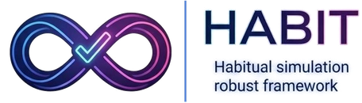<br>
      <b>HABIT (AAAI'26)</b><br>
      <span style="font-size: 0.9em;">
        <a href="https://ojs.aaai.org/index.php/AAAI/article/view/37608" target="_blank">Paper</a> |
        <a href="https://lee-zixu.github.io/HABIT.github.io/" target="_blank">Project</a> |
        <a href="https://github.com/iLearn-Lab/AAAI26-HABIT" target="_blank">Code</a>
      </span>
    </td>
    <td style="width:33%; border:none; vertical-align:top; padding-top:30px;">
      <br>
      <b>ReTrack (AAAI'26)</b><br>
      <span style="font-size: 0.9em;">
        <a href="https://ojs.aaai.org/index.php/AAAI/article/view/39507" target="_blank">Paper</a> |
        <a href="https://lee-zixu.github.io/ReTrack.github.io/" target="_blank">Project</a> |
        <a href="https://github.com/iLearn-Lab/AAAI26-ReTrack" target="_blank">Code</a>
      </span>
    </td>
    <td style="width:33%; border:none; vertical-align:top; padding-top:30px;">
      <br>
      <b>INTENT (AAAI'26)</b><br>
      <span style="font-size: 0.9em;">
        <a href="https://ojs.aaai.org/index.php/AAAI/article/view/39181" target="_blank">Paper</a> |
        <a href="https://zivchen-ty.github.io/INTENT.github.io/" target="_blank">Project</a> |
        <a href="https://github.com/ZivChen-Ty/INTENT" target="_blank">Code</a>
      </span>
    </td>
  </tr>
  <tr style="border:none;">
    <td style="width:33%; border:none; vertical-align:top; padding-top:30px;">
      <br>
      <b>HUD (ACM MM'25)</b><br>
      <span style="font-size: 0.9em;">
        <a href="https://dl.acm.org/doi/10.1145/3746027.3755445" target="_blank">Paper</a> |
        <a href="https://zivchen-ty.github.io/HUD.github.io/" target="_blank">Project</a> |
        <a href="https://github.com/ZivChen-Ty/HUD" target="_blank">Code</a>
      </span>
    </td>
    <td style="width:33%; border:none; vertical-align:top; padding-top:30px;">
      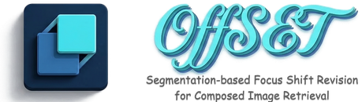<br>
      <b>OFFSET (ACM MM'25)</b><br>
      <span style="font-size: 0.9em;">
        <a href="https://dl.acm.org/doi/10.1145/3746027.3755366" target="_blank">Paper</a> |
        <a href="https://zivchen-ty.github.io/OFFSET.github.io/" target="_blank">Project</a> |
        <a href="https://github.com/ZivChen-Ty/OFFSET" target="_blank">Code</a>
      </span>
    </td>
    <td style="width:33%; border:none; vertical-align:top; padding-top:30px;">
      <br>
      <b>ENCODER (AAAI'25)</b><br>
      <span style="font-size: 0.9em;">
        <a href="https://ojs.aaai.org/index.php/AAAI/article/view/32541" target="_blank">Paper</a> |
        <a href="https://sdu-l.github.io/ENCODER.github.io/" target="_blank">Project</a> |
        <a href="https://github.com/Lee-zixu/ENCODER" target="_blank">Code</a>
      </span>
    </td>
  </tr>
</table>

## 🫡 Support & Contributing

We welcome all forms of contributions! If you have questions, ideas, or find a bug, please:

- Open an [Issue](https://github.com/zh-mingyu/Traw-Mem/issues) for discussions or bug reports.
- Submit a [Pull Request](https://github.com/zh-mingyu/Traw-Mem/pulls) to improve the codebase.

[⬆ Back to top](#top)

## 📄 License

This project is released under the terms of the [LICENSE](./LICENSE) file included in this repository.

<div align="center">
  

  <br><br>

  <a href="https://github.com/zh-mingyu/Traw-Mem">
    
  </a>
  <a href="https://github.com/zh-mingyu/Traw-Mem/issues">
    
  </a>
  <a href="https://github.com/zh-mingyu/Traw-Mem/pulls">
    
  </a>

  <br><br>
  <a href="https://github.com/zh-mingyu/Traw-Mem">
    
  </a>
</div>
